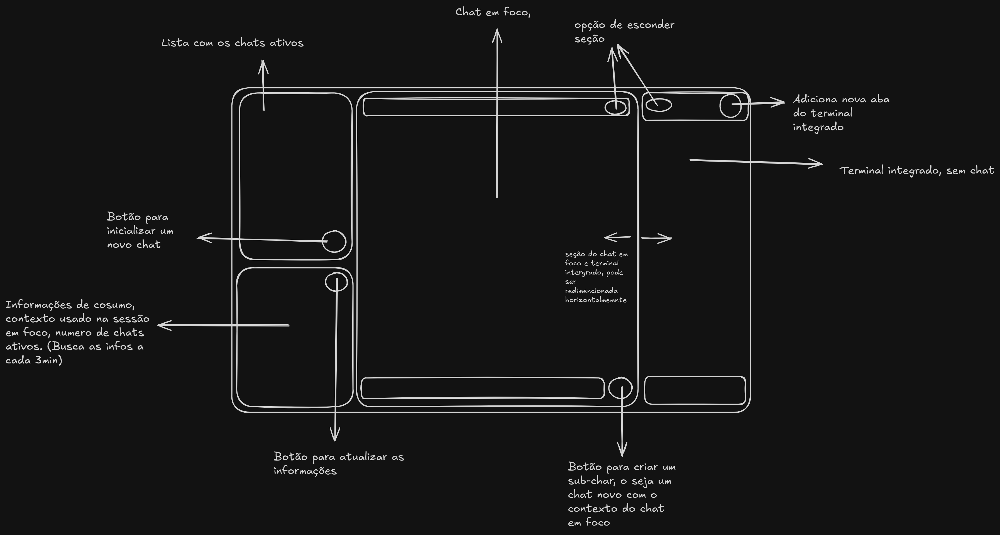

# C-hub

Gerenciador de sessões do [Claude Code](https://claude.com/claude-code) e do [Codex](https://github.com/openai/codex) para o
desktop Linux, com um app Android para acompanhar e criar sessões pelo celular.

Cada chat é o `claude` ou o `codex` interativo rodando num **tmux**, no seu PC ou num servidor (VPS) por SSH. Fechar o app só
desconecta: o agente continua trabalhando, e dá para entrar na mesma sessão pelo desktop, pelo celular ou por um terminal.



> Projeto pessoal, sem ligação com a Anthropic ou a OpenAI. Interface e documentação em português do Brasil.

## O que tem

**Desktop** (Rust + GTK4 + VTE; testado no [Omarchy](https://omarchy.org), Arch + Hyprland)

- Lista de chats ativos agrupada por lugar e pasta, com o status de cada um: trabalhando, precisa de você, pronto, terminou
- Chats locais num tmux próprio (`tmux -L chube`): sobrevivem ao fechamento do app, e o celular entra neles
- **Sessões numa VPS** por SSH, cada uma num tmux de lá; o painel de sessões mostra os tmux abertos e as sessões salvas de lá
- Sessões salvas para retomar e sub-chats (um chat novo com o contexto do chat em foco)
- Seletor de modo de permissão do Claude, painel de consumo do plano e do contexto do chat
- Terminal integrado com abas, ao lado do chat
- Temas: segue o tema do Omarchy (cores, fonte, modo vidro) ou usa um dos próprios (Tokyo Night, Catppuccin, Gruvbox,
  Nord…), com editor de cores
- Atalhos de pasta no painel de nova sessão (também lê e edita o `~/.shortcuts` do `fshort`)

**Android** (Kotlin + Jetpack Compose, em [`android/`](android/))

- Sem sessão local: entra por SSH nos tmux do PC e dos servidores, com o terminal do [Termux](https://github.com/termux/termux-app)
- Lista com o status de cada chat; cria sessões novas, retoma sessões salvas, encerra
- Chave SSH guardada no Keystore do Android, liberada pela biometria a cada conexão
- Os mesmos temas e atalhos de pasta do desktop (lidos do PC)

## Instalar

O passo a passo completo, com o servidor e o celular, está em **[docs/configuracao.md](docs/configuracao.md)**.

Resumo do desktop no Arch/Omarchy:

```sh
sudo pacman -S --needed rust gtk4 vte4 tmux openssh
git clone https://github.com/Pedro-AS7/c-hub.git && cd c-hub
./install.sh             # compila em release e instala para o usuário (sem sudo)
./install.sh --uninstall # remove
```

Instala o binário em `~/.local/bin/chube`, o ícone e o atalho `.desktop` no launcher. Precisa do `claude` e/ou do `codex`
instalados e logados. Outras distros e requisitos: [docs/configuracao.md](docs/configuracao.md#1-desktop).

Opções: `chube [--agent omarchy|claude|codex] [--model <modelo>] [--open-directory <pasta>] [-- <pastas>…]`. `--agent`
escolhe o agente das pastas abertas pela linha de comando ou pelo gerenciador de arquivos; `--model` define o modelo dos
chats novos desse agente.

## Como funciona

```
  PC com o C-hub desktop                 VPS
  tmux -L chube                          tmux
    chube-1a2b3c4d  (claude)               chube-9f8e7d6c  (claude)
    chube-5e6f7a8b  (codex)                chube-0a1b2c3d  (codex)
          ^                                      ^
          |  ssh (sshd, só chave, pelo Tailscale) |  ssh
          +------- celular (C-hub Android) -------+
```

- O desktop abre os chats da VPS com `ssh -t <host>` e os locais direto no tmux daqui.
- O nome da sessão (`chube-<8 hex>`), as opções do tmux e os scripts são os mesmos no desktop (`src/remote.rs`) e no
  Android (`android/app/src/main/java/com/pedro/chub/ssh/Scripts.kt`): os dois veem e criam as mesmas sessões.
- O status vem do próprio Claude Code (`~/.claude/sessions/<pid>.json`) e do título do terminal; o contexto e o modelo vêm
  do histórico da sessão. Nada é gravado no servidor além do que o agente e o tmux já gravam.
- Usa o login existente de cada CLI e tira `ANTHROPIC_API_KEY`/`OPENAI_API_KEY` do ambiente dos chats: o uso sai do
  plano, não da API.

## Contribuir

Issues e pull requests são bem-vindos. O **[CONTRIBUTING.md](CONTRIBUTING.md)** explica como montar o ambiente, rodar os
testes e o que conferir antes do PR.

## Licença

[GPL-3.0-only](LICENSE). O emulador e a view de terminal em `android/terminal/` vêm do
[Termux](https://github.com/termux/termux-app) (Apache 2.0, veja `android/terminal/TERMUX-LICENSE.md`). A fonte
JetBrains Mono Nerd Font do app Android é distribuída sob a SIL Open Font License (`android/licenses/`).
