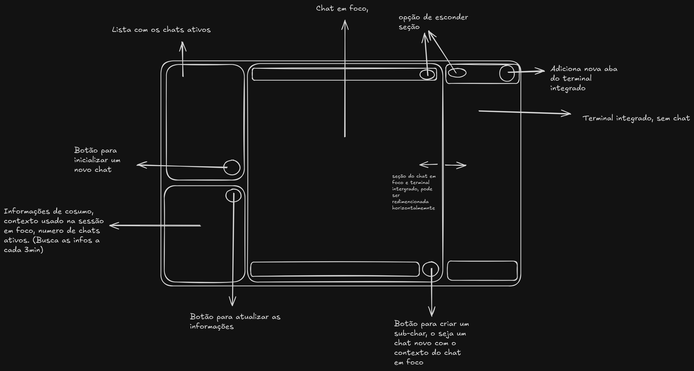

# C-hub

Gerenciador de sessões do [Claude Code](https://claude.com/claude-code) e do [Codex](https://learn.chatgpt.com/docs/cli/reference) para o desktop COSMIC (Pop!_OS 24.04, Wayland),
feito em Rust com o [libcosmic](https://github.com/pop-os/libcosmic).



- Lista de chats ativos, cada um com o `claude` ou `codex` interativo num terminal integrado
- Sessões salvas para retomar, e sub-chats (um chat novo com o contexto do chat em foco)
- Painel de consumo do plano (limites de 5 h e da semana) e do contexto usado no chat em foco
- Terminal integrado com abas, ao lado do chat
- Temas: sistema, fósforo, neon e gruvbox

Escolha **Claude Code** ou **Codex** no diálogo "Nova sessão". Chats dos dois agentes convivem na mesma lista, identificados pelo nome. Sessões salvas, retomada, sub-chats e restauração ao abrir preservam o agente de origem.

Usa o login existente de cada CLI. O seletor de permissões do C-hub é exclusivo do Claude; no Codex, use os controles da própria TUI (`/permissions`, `/plan`, `/model`). Limites e contexto do Codex vêm do histórico local, quando disponíveis; `/status` mostra os dados da CLI.

> Projeto pessoal, sem ligação com a Anthropic ou a OpenAI.

## Requisitos

- Rust (edition 2024) e as dependências de compilação do libcosmic
- A CLI do agente desejado instalada e logada: Claude Code (`claude` no `PATH` ou em `~/.local/bin`) e/ou Codex (testado com 0.163.0; `codex` no `PATH`, em `~/.local/bin` ou instalado pelo nvm)
- Sessão Wayland. Feito para o COSMIC; também roda no GNOME, seguindo o tema do COSMIC

## Instalar

```sh
./install.sh             # compila em release e instala para o usuário (sem sudo)
./install.sh --uninstall # remove
```

Instala o binário em `~/.local/bin/chube`, o ícone e o atalho `.desktop` no launcher.
Para só rodar: `cargo run --release`. Opções: `chube --agent codex` escolhe o agente inicial do diálogo (padrão: `claude`); `--model <modelo>` define o modelo dos chats novos desse agente. Para o outro agente, vale o modelo configurado na própria CLI.

## Licença

[GPL-3.0-only](LICENSE). O terminal em `src/term/` é adaptado do [cosmic-term](https://github.com/pop-os/cosmic-term)
(© System76, GPL-3.0-only).
